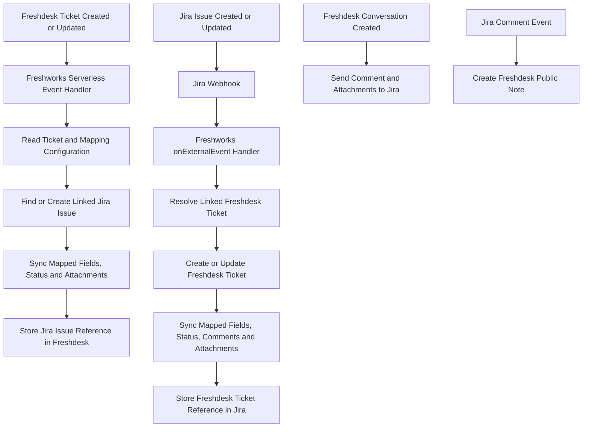

 🔄 Freshdesk ↔ Jira Two-Way Synchronization

### A serverless integration that connects customer support tickets with Jira issues

Keep selected ticket and issue information aligned across Freshdesk and Jira Cloud using event-driven synchronization.


---

## 📖 Overview

**Freshdesk ↔ Jira Two-Way Synchronization** is a Freshworks serverless app that connects Freshdesk support tickets with Jira Cloud issues. It listens for Freshdesk ticket and conversation events and receives Jira webhook events through the Freshworks external-event handler.

The integration is designed to reduce manual updates between customer support and engineering teams. When a mapped field or supported activity changes in one platform, the app can update the linked record in the other platform.

The app is configurable: Jira project custom-field IDs, Freshdesk custom-field names, status mappings, priority mappings, and synchronization settings are supplied through Freshworks installation parameters.

> **Project type:** Event-driven Freshdesk serverless app. The supplied source does not include a custom sidebar or other front-end interface. Configuration and synchronization run through Freshworks app events and Jira webhooks.

## ✨ Features

### Freshdesk → Jira

- Create a Jira issue when a new Freshdesk ticket is received, provided the ticket has a configured Jira project mapping and is not already linked to an issue.
- Update the linked Jira issue when supported Freshdesk ticket fields change.
- Synchronize ticket subject/summary, description, priority, mapped custom fields, and status.
- Convert Freshdesk status IDs to Jira workflow statuses using configurable mappings and Jira transitions.
- Send Freshdesk conversations to the linked Jira issue as comments.
- Transfer Freshdesk ticket and conversation attachments to Jira.
- Store the Jira issue key and URL on the Freshdesk ticket using configured custom fields.

### Jira → Freshdesk

- Receive Jira issue events through the Freshworks `onExternalEvent` handler.
- Create a Freshdesk ticket when a new Jira issue is received, when the project is configured, synchronization is allowed, and the issue is not already linked.
- Update the linked Freshdesk ticket when supported Jira issue fields change.
- Synchronize Jira summary, description, priority, status, and configured custom fields to Freshdesk.
- Convert Jira status names to Freshdesk status IDs using configurable mappings.
- Copy new Jira comments to Freshdesk as public notes.
- Transfer supported Jira issue/comment attachments to Freshdesk notes.
- Store the Freshdesk ticket ID in configured Jira custom fields to maintain the relationship between both records.

### Synchronization safeguards and recovery

- Check existing ticket/issue links before creating records to reduce duplicate creation.
- Compare current values before sending field updates, avoiding unnecessary updates when values already match.
- Add identifying markers/prefixes to synchronized comments and notes to help prevent synchronization loops and duplicate comment copies.
- Resolve missing links through configured fields and fallback searches.
- Attempt to reconcile missing historical comments, conversations, and attachments after relevant Jira webhook events.
- Support configurable attachment size limits, comment retry attempts, retry delays, text labels, and status aliases.

## 🔁 How It Works

The integration uses Freshdesk app events for Freshdesk-originated changes and Jira webhooks for Jira-originated changes.



### Freshdesk event handlers

| Freshdesk event | Purpose |
|---|---|
| `onTicketCreate` | Creates a Jira issue for an eligible, unlinked ticket. |
| `onTicketUpdate` | Updates mapped Jira fields and workflow status for the linked issue. |
| `onConversationCreate` | Sends the Freshdesk conversation and supported attachments to Jira. |

### Jira webhook events

The app receives Jira webhook payloads through the Freshworks `onExternalEvent` handler. The server code specifically handles Jira issue creation, issue updates, and comment payloads carried by webhook events. Configure the Jira webhook to send the relevant issue-created, issue-updated, comment-created, and comment-updated events to the target URL generated by the Freshworks app installation flow. Note that the current duplicate guard skips a comment when its marker is already present in Freshdesk; edits to an already-synchronized comment are not updated in place.

## 🧰 Technology Stack

| Component | Technology |
|---|---|
| App platform | Freshworks Developer Platform, Platform v3 |
| App architecture | Freshworks serverless app / event handlers |
| Runtime declared in manifest | Node.js 24.11.1 |
| Freshworks CLI declared in manifest | FDK 10.1.10 |
| Language | JavaScript (Node.js) |
| HTTP client | Axios |
| Binary handling | Node.js Buffer / `buffer` package |
| Freshdesk integration | Freshdesk REST API v2 and Freshworks request templates |
| Jira integration | Jira Cloud REST API v3 and Jira webhooks |
| Unit testing | Vitest and V8 coverage provider |

## 🗂️ Project Structure

```text
freshdesk-jira-two-way-sync/
├── config/
│   ├── iparams.json              # Add a sanitized installation-parameter schema
│   └── requests.json             # Freshdesk and Jira request templates
│
├── server/
│   ├── lib/
│   │   └── handle-response.js    # Shared response helper
│   └── server.js                 # Synchronization logic and event handlers
│
├── tests/
│   └── server.test.js            # Vitest handler/helper tests
│
├── manifest.json                # Freshworks app manifest and event registrations
├── package.json                 # Dependencies and test script
├── package-lock.json
├── vitest.config.js              # Vitest configuration
└── README.md
```

**Repository preparation note:** The ZIP supplied for this README contains `iparams.json.backup` at the project root but does not contain the expected `config/iparams.json` installation-parameter schema. Create and review a sanitized `config/iparams.json` before running FDK validation or packaging. Do not commit the backup file or account-specific defaults.

## ⚙️ Configuration

The app uses Freshworks installation parameters (`iparams`) for connection details and synchronization mappings. Configure these values for your own Freshdesk account and Jira Cloud site.

### Connection parameters

| Parameter | Purpose |
|---|---|
| `freshdesk_domain` | Freshdesk account hostname, without `https://` |
| `freshdesk_api_key` | Freshdesk API key used by the serverless app |
| `jira_domain` | Jira Cloud hostname, without `https://` |
| `jira_email` | Jira account email associated with the API token |
| `jira_api_token` | Jira Cloud API token |
| `jira_project` | Default Jira project key used as a fallback |
| `jira_issue_type` | Default Jira issue type, such as Task or Bug |

The Freshdesk API key and Jira API token must be configured as secure installation parameters. Never hard-code credentials in source files or commit real credential values to GitHub.

### Mapping parameters

| Parameter | Purpose |
|---|---|
| `project_custom_fields` | Jira custom-field IDs and field types for each Jira project. The ticket ID and sync-to-Freshdesk fields are required for each configured project. |
| `freshdesk_fields` | Freshdesk custom-field names and the mapping between Freshdesk fields and Jira fields. |
| `status_mapping` | Maps Freshdesk status IDs to Jira status names and Jira status names back to Freshdesk status IDs. Optional aliases can normalize equivalent status names. |
| `priority_mapping` | Maps Freshdesk priority IDs to Jira priority names and defines fallback priorities. |
| `general_settings` | Controls sync toggle values, default status, attachment size, attachment delay, and comment retry settings. |
| `text_labels` | Controls prefixes and user-visible labels used in synchronized comments and attachment notes. |

### Custom-field mapping requirements

- Configure a separate Jira custom-field map for every Jira project that should participate in synchronization.
- Each project mapping must include a `ticketId` field and a `syncToFreshDesk` field with valid Jira custom-field IDs and types.
- Configure the Freshdesk custom-field names that correspond to the Jira fields you want to synchronize.
- Configure fields used to store the Jira issue key, Jira issue URL, and Freshdesk ticket ID so that the app can resolve the relationship between records.
- Make sure the Freshdesk fields and Jira custom fields exist and that the API user has permission to read and update them.

A simplified example of the **shape** of a project mapping is shown below. Replace the example IDs with the IDs from your own Jira site; these values are placeholders only.

```json
{
  "DEMO": {
    "ticketId": {
      "id": "customfield_12345",
      "type": "string"
    },
    "syncToFreshDesk": {
      "id": "customfield_12346",
      "type": "select"
    },
    "freshdeskId": "customfield_12347"
  }
}
```

## 🔌 API Operations Used

The request templates in `config/requests.json` define the app's Freshdesk and Jira HTTP operations.

### Freshdesk API operations

- Retrieve a ticket.
- Search for tickets using configured link fields.
- Create a ticket from a Jira issue.
- Update a ticket with Jira-originated changes or issue-link information.
- Create ticket notes for Jira comments and attachment transfers.

### Jira Cloud API operations

- Create and update issues.
- Retrieve issues and workflow transitions.
- Search issues using JQL to recover a missing ticket/issue link.
- Execute workflow transitions.
- Add issue comments.
- Upload and retrieve issue attachments.

The implementation uses Freshworks request templates where configured and includes Axios HTTP fallbacks for several operations.

## 🚀 Getting Started

### Prerequisites

- A Freshdesk account where you are authorized to install and configure custom apps.
- A Jira Cloud site and a Jira account with an API token.
- Node.js and a compatible Freshworks Developer Kit (FDK) installation. The supplied `manifest.json` declares Node.js `24.11.1` and FDK `10.1.10`.
- Freshdesk custom fields and Jira project custom fields configured for the mapping you intend to use.
- Permission for the integration accounts to create/update tickets and issues, add notes/comments, transition Jira issues, and read/upload attachments as required.

Official setup references:

- [Freshworks CLI setup](https://developers.freshworks.com/docs/guides/setup/cli-setup/)
- [Freshworks CLI command reference](https://developers.freshworks.com/docs/app-sdk/v3.0/task/basic-dev-tools/freshworks-cli/)
- [Jira Cloud REST API v3](https://developer.atlassian.com/cloud/jira/platform/rest/v3/intro/)
- [Freshdesk API documentation](https://developers.freshdesk.com/api/)

### 1. Clone the repository

```bash
git clone https://github.com/yuvanshankar-work/FreshDesk-Jira-Two-Way-Sync-.git freshdesk-jira-two-way-sync
cd freshdesk-jira-two-way-sync
```

If your GitHub repository has a different name, replace the URL and directory name with your repository's actual values.

### 2. Restore the installation parameter schema

Before running or packaging the app, add a reviewed and sanitized `config/iparams.json` file. The supplied ZIP does not contain this file in the expected location. Use the parameter names documented above and create the installation form for your own environment. Do not copy account-specific field IDs or defaults from the backup without reviewing and replacing them.

### 3. Install dependencies

```bash
npm install
```

### 4. Run the unit tests

```bash
npm run fdk-unit-test
```

The current test file checks that the expected event handlers are exported and verifies the shared response helper for basic success/error cases. It does not exercise live Freshdesk/Jira API calls or fully test end-to-end synchronization.

### 5. Run the app locally

```bash
fdk run
```

Use the Freshworks local testing workflow to supply test installation parameters and trigger the relevant events. Do not use production API credentials or real customer data for local tests.

### 6. Validate the app

```bash
fdk validate
```

Resolve validation findings before packaging. The current source snapshot also declares Axios in both `package.json` and `manifest.json` with different version ranges; review and align the dependency declarations before a production build.

### 7. Package the app

```bash
fdk pack
```

The Freshworks CLI generates a package under the `dist/` directory. Keep generated build output out of source control unless there is a specific reason to version a release artifact.

## 🧪 Testing

The repository includes:

- `tests/server.test.js` — checks the expected serverless event-handler exports and the shared response helper's basic behavior.
- `vitest.config.js` — configures Vitest and the V8 coverage provider.
- `npm run fdk-unit-test` — executes the configured Vitest run with coverage.

These tests are a starting point. Add mocked tests for the field mapping logic, status transitions, duplicate prevention, webhook processing, comment synchronization, and attachment handling. Add sandbox integration tests against non-production Freshdesk and Jira instances before relying on the integration in a live workflow.

## 🔐 Security and Operational Considerations

This integration can process customer communications, ticket descriptions, issue details, and file attachments. Treat the connected accounts and all synchronized data as sensitive.

- Store the Freshdesk API key and Jira API token only in secure Freshworks installation parameters or another approved secrets store.
- Never commit API tokens, customer data, signed attachment URLs, webhook samples containing personal information, local logs, or generated ZIP packages.
- Remove or redact verbose logging of complete event arguments and webhook payloads before production. The current source contains payload-level logging that may expose customer or issue information in app logs.
- Review how Jira webhooks are authenticated and restricted before exposing the generated target URL to production traffic. The current payload validation checks for an issue object; it should not be treated as a complete webhook-signature or source-authentication control.
- Apply least-privilege permissions to both integration accounts.
- Review field-level privacy requirements before copying Freshdesk conversations into Jira or Jira comments into Freshdesk public notes.
- Validate attachment type and size policies for your organization. The app contains configurable attachment-size handling, but this does not replace malware scanning or a formal file-security review.
- Test status and priority mappings against the actual workflows in each Jira project and Freshdesk account.
- Use non-production tickets and issues for testing; verify that loop prevention and duplicate checks work for your chosen workflow.

## ⚠️ Current Scope and Known Limitations

- The supplied source is a serverless event-driven app. It does not include a Freshdesk sidebar UI or a custom front-end experience.
- Synchronization depends on correctly configured Freshdesk and Jira credentials, custom fields, per-project mappings, and Jira webhooks.
- Only fields covered by the configured mapping and implemented synchronization logic are synchronized. This is not an automatic mirror of every field in either platform.
- Jira-to-Freshdesk issue updates depend on resolving a linked Freshdesk ticket and on the project's sync configuration.
- The provided test suite is limited and does not prove that the integration works end to end against live services.
- The current comment deduplication logic prevents duplicate copies, but an edit to a previously synchronized Jira comment is not applied as an edit to the existing Freshdesk note.
- The uploaded project snapshot needs a sanitized `config/iparams.json` file and dependency-version alignment before it can be considered ready for validation and packaging.
- Production use requires a security review of webhook authenticity, payload logging, API permissions, error handling, and sensitive-data handling.

## 🛣️ Recommended Next Improvements

- [ ] Add a sanitized `config/iparams.json` installation schema and a safe example configuration.
- [ ] Align dependency declarations across `package.json` and `manifest.json`.
- [ ] Add unit tests for mapping, webhook, deduplication, status, comment, and attachment paths.
- [ ] Add non-production end-to-end tests for both synchronization directions.
- [ ] Redact sensitive values and customer data from logs.
- [ ] Add and document webhook authentication/verification controls.
- [ ] Add structured error reporting and operational monitoring.
- [ ] Document the exact Jira webhook event configuration and required custom fields for each target environment.

## 👨‍💻 Author

**Yuvan Shankar U K**

- GitHub: [@yuvanshankar-work](https://github.com/yuvanshankar-work)
- Repository: [Freshdesk Jira Two-Way Sync](https://github.com/yuvanshankar-work/FreshDesk-Jira-Two-Way-Sync-)

---

**Freshdesk ↔ Jira — keeping support and engineering work connected.**

Built with the Freshworks Developer Platform and Jira Cloud REST APIs.
